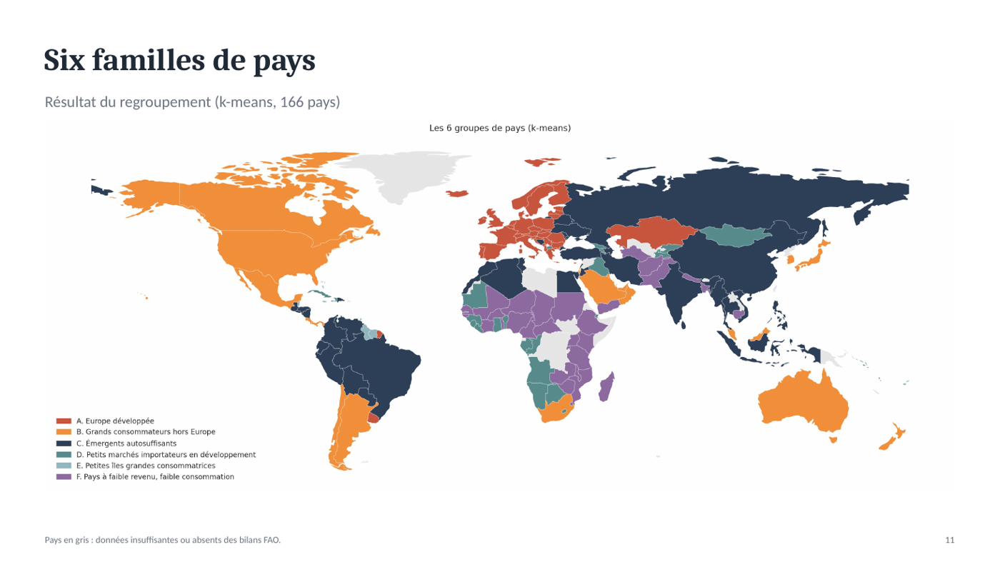

# La poule qui chante — où exporter nos poulets bio ? (ACP et clustering)

> 166 pays, 13 indicateurs PESTEL, une ACP et deux méthodes de clustering : 6 familles de pays, 1 famille prioritaire et 4 pays pour démarrer l'export, avec l'Allemagne en tête.



**Projet 11 · OpenClassrooms Data Analyst · septembre 2026** · Python · pandas · scikit-learn (ACP, CAH, k-means) · API Banque mondiale · geopandas · Présentation COMEX

---

## Besoin métier
Une PME française de volaille bio, 100 % France aujourd'hui, veut exporter. Aucun pays n'est présélectionné. Le COMEX attend des **groupes de pays à cibler** avant de lancer une étude de marché approfondie. Un pays cible doit réunir 4 conditions :
- un pouvoir d'achat suffisant ;
- un marché déjà importateur ;
- un risque maîtrisé ;
- une proximité qui permet de livrer du frais.

## Données
- **Sources :** FAO (bilans alimentaires 2017, population) et **API Banque mondiale** (PIB/hab en PPA, stabilité politique, performance logistique, qualité réglementaire, urbanisation), plus la distance à Paris.
- **13 indicateurs**, dont 5 créés : part de la volaille importée, kg/hab, part de la volaille dans la viande, etc.
- **Couverture :** 166 pays, soit 96 % de la population mondiale.
  - 6 pays ont été exclus faute de données.
  - 27 valeurs ont été complétées, soit 1 % des valeurs.
  - La Chine n'est pas comptée deux fois.

## Démarche
1. **Collecter et préparer :** nettoyer, harmoniser les codes pays (`country_converter`), mettre l'appel à l'API en cache.
2. **ACP :** 4 axes conservent 77 % de l'information. Ils correspondent au niveau de développement (40 %), à l'arbitrage taille / dépendance aux importations (17 %), à la culture volaille (10 %) et au volume importé (10 %).
3. **Clustering en deux temps :** la **CAH** indique le nombre de familles (6), puis le **k-means** affine.
   - L'affectation est stable à 98 % sur 20 initialisations.
   - La silhouette vaut 0,22.
4. **Priorisation :** les familles sont confrontées aux 4 critères, puis un **score d'attractivité** à 7 indicateurs est testé sous plusieurs pondérations.

## Résultats
| Famille | Décision |
|---|---|
| A. Europe développée (36 pays) | **Priorité** : remplit les 4 critères |
| B. Grands consommateurs hors Europe (20) | Phase 2, pays par pays (Émirats, Hong Kong, Japon, Arabie saoudite) |
| C, D, E, F | Écartées : autosuffisance, pouvoir d'achat, taille du marché ou revenu |

**Le pays qui ressort, l'Allemagne :**
- 1er importateur européen de volaille (842 kt) ;
- 36 % de son marché est servi par les importations ;
- PIB/hab de 62 k$ en PPA ;
- 878 km de Paris, ce qui permet de livrer du frais ;
- pas de droits de douane et label bio européen reconnu.

**Feuille de route :**
1. **Phase 1 :** Allemagne, Pays-Bas, Royaume-Uni et Danemark, en frais.
2. **Extension :** Autriche, Belgique et Tchéquie.
3. **Phase 2 :** grand export en congelé.

## Limites
- Les données datent de 2017 : le Brexit et les évolutions récentes ne sont pas reflétés.
- Aucune donnée ne mesure la demande « bio » ni les prix : c'est l'objet de l'étude de marché.
- Les barrières réglementaires (quotas, certification halal, normes sanitaires) ne sont pas modélisées.
- Les frontières entre familles restent floues : la famille B est hétérogène, et l'accord CAH / k-means a un ARI de 0,43.

## Compétences mobilisées
`Python` · `ACP` · `CAH` · `k-means` · `Silhouette / stabilité` · `API REST` · `Cartographie (geopandas)` · `Restitution COMEX`

## Contenu
```
notebooks/
  Cabart_Leo_1_preparation_nettoyage_analyse_exploratoire_092026.ipynb
  Cabart_Leo_2_clustering_visualisations_092026.ipynb
data/       # p11_countries_clean.csv, p11_countries_clusters.csv, population FAO
figures/    # cercles des corrélations, projections, carte, shortlist
livrables/Cabart_Leo_3_presentation_092026.pdf   # présentation COMEX
```
Le fichier FAO « Disponibilité alimentaire 2017 » (33 Mo) n'est pas versionné. Le notebook 2 tourne directement sur `data/p11_countries_clean.csv`.

---
Leo Cabart · Data Analyst · [Portfolio](https://lcabart21.github.io) · [GitHub](https://github.com/lcabart21)
